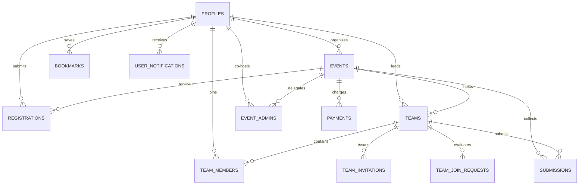

# Hacker's Unity — Database Schema & Data Models

> **Document Type:** PostgreSQL / Supabase Schema Specification  
> **Database Engine:** PostgreSQL 16 on Supabase  
> **Target Schema:** `public`  
> **Version:** 2.6.0  
> **Last Updated:** October 2026  

---

## 1. Schema Topology & Entity-Relationship Architecture

---

## 2. Table Specifications

### 2.1. `public.profiles`
Stores user profile information, synced with `auth.users` on signup.

| Column | Type | Constraints | Description |
| :--- | :--- | :--- | :--- |
| `id` | `UUID` | `PRIMARY KEY, REFERENCES auth.users(id)` | User unique identifier |
| `name` | `TEXT` | `NOT NULL` | Full display name |
| `email` | `TEXT` | `NOT NULL, UNIQUE` | User primary email |
| `username` | `TEXT` | `UNIQUE` | URL slug handle (`/profile/[username]`) |
| `avatar_url` | `TEXT` | | Supabase Storage URL |
| `banner_url` | `TEXT` | | Supabase Storage URL |
| `bio` | `TEXT` | | Short biography |
| `headline` | `TEXT` | | Professional headline |
| `profession` | `TEXT` | | `STUDENT`, `PROFESSIONAL`, `FREELANCER` |
| `college` | `TEXT` | | College or University name |
| `degree` | `TEXT` | | Academic degree (e.g., B.Tech) |
| `branch` | `TEXT` | | Major branch (e.g., ECE, CSE) |
| `graduation_year`| `INTEGER` | | Expected year of graduation |
| `roll_number` | `TEXT` | | College roll number (e.g., `2024uec1377`) |
| `organization`| `TEXT` | | Company or organization |
| `github_url` | `TEXT` | | GitHub profile URL |
| `linkedin_url`| `TEXT` | | LinkedIn profile URL |
| `portfolio_url`| `TEXT` | | Personal website URL |
| `skills` | `TEXT[]` | `DEFAULT '{}'` | Array of technical skills |
| `elo_rating` | `INTEGER` | `DEFAULT 1200` | Competitive hacker Elo rating |
| `created_at` | `TIMESTAMPTZ` | `DEFAULT NOW()` | Record creation timestamp |
| `updated_at` | `TIMESTAMPTZ` | `DEFAULT NOW()` | Record modification timestamp |

---

### 2.2. `public.events`
Core hackathon and technical competition entity.

| Column | Type | Constraints | Description |
| :--- | :--- | :--- | :--- |
| `id` | `TEXT / UUID` | `PRIMARY KEY` | Event ID (e.g. `evt_ai_...` or UUID) |
| `slug` | `TEXT` | `NOT NULL, UNIQUE` | URL slug handle (`/hackathons/[slug]`) |
| `title` | `TEXT` | `NOT NULL` | Hackathon title |
| `tagline` | `TEXT` | | Short marketing tagline |
| `description` | `TEXT` | | Detailed HTML/Markdown overview |
| `category` | `TEXT` | `DEFAULT 'HACKATHON'`| Category enum |
| `event_type` | `TEXT` | `DEFAULT 'ONLINE'` | `ONLINE`, `OFFLINE`, `HYBRID` |
| `status` | `TEXT` | `DEFAULT 'DRAFT'` | `DRAFT`, `PUBLISHED`, `CLOSED` |
| `location` | `TEXT` | | Physical venue or city |
| `venue` | `JSONB` | | Detailed venue metadata |
| `start_date` | `TIMESTAMPTZ` | `NOT NULL` | Hackathon kick-off time |
| `end_date` | `TIMESTAMPTZ` | `NOT NULL` | Hackathon conclusion time |
| `registration_start`| `TIMESTAMPTZ` | | When registration opens |
| `registration_deadline`| `TIMESTAMPTZ`| | Final registration deadline |
| `organizer_id` | `UUID` | `REFERENCES profiles(id)`| Primary host & creator |
| `organizer_name` | `TEXT` | | Host organization name |
| `organizer_avatar`| `TEXT` | | Host logo URL |
| `logo_url` | `TEXT` | | Event square badge |
| `banner_url` | `TEXT` | | 16:9 Event hero banner |
| `prize_pool` | `BIGINT` | `DEFAULT 0` | Total prize pool in INR |
| `prizes` | `JSONB` | `DEFAULT '[]'` | Breakdown of prize tiers & tracks |
| `tracks` | `JSONB` | `DEFAULT '[]'` | Competition tracks and bounties |
| `sponsors` | `JSONB` | `DEFAULT '[]'` | Sponsor cards and logos |
| `rules` | `TEXT` | | Code of conduct and rules |
| `eligibility` | `TEXT` | | Eligibility criteria |
| `custom_questions`| `JSONB` | `DEFAULT '[]'` | Dynamic registration form schema |
| `submission_deliverables`| `JSONB` | | Mandatory & optional submission keys |
| `registration_count`| `INTEGER` | `DEFAULT 0` | Auto-incremented participant count |
| `is_paid` | `BOOLEAN` | `DEFAULT FALSE` | Paid hackathon toggle |
| `ticket_price` | `NUMERIC` | `DEFAULT 0` | Ticket fee in INR |
| `admin_invite_code` | `TEXT` | `UNIQUE` | Secret code for co-host joining |
| `is_approved` | `BOOLEAN` | `DEFAULT FALSE` | Platform super admin approval |
| `is_featured` | `BOOLEAN` | `DEFAULT FALSE` | Landing page showcase toggle |

---

### 2.3. `public.event_admins`
Delegated administrative co-hosts for hackathons.

| Column | Type | Constraints | Description |
| :--- | :--- | :--- | :--- |
| `id` | `UUID` | `PRIMARY KEY DEFAULT gen_random_uuid()` | Admin record identifier |
| `event_id` | `TEXT` | `NOT NULL, REFERENCES events(id) ON DELETE CASCADE` | Associated event |
| `user_id` | `UUID` | `NOT NULL, REFERENCES profiles(id) ON DELETE CASCADE` | Co-host user ID |
| `role` | `TEXT` | `DEFAULT 'ADMIN'` | Role (`ADMIN`, `JUDGE`, `REVIEWER`) |
| `invited_by` | `UUID` | `REFERENCES profiles(id)` | Host who generated the invite |
| `joined_at` | `TIMESTAMPTZ` | `DEFAULT NOW()` | When the co-host accepted invite |

---

### 2.4. `public.registrations`
Participant registration records for individual and team applicants.

| Column | Type | Constraints | Description |
| :--- | :--- | :--- | :--- |
| `id` | `UUID` | `PRIMARY KEY DEFAULT gen_random_uuid()` | Registration ID |
| `event_id` | `TEXT` | `NOT NULL, REFERENCES events(id) ON DELETE CASCADE` | Target event |
| `user_id` | `UUID` | `NOT NULL, REFERENCES profiles(id) ON DELETE CASCADE` | Registered user |
| `team_id` | `UUID` | `REFERENCES teams(id) ON DELETE SET NULL` | Associated squad ID (if team) |
| `status` | `TEXT` | `DEFAULT 'PENDING'` | `PENDING`, `APPROVED`, `REJECTED`, `WAITLISTED` |
| `custom_answers`| `JSONB` | `DEFAULT '{}'` | Answers to custom questionnaire |
| `attendance_status`| `TEXT` | `DEFAULT 'NOT_CONFIRMED'` | `NOT_CONFIRMED`, `RSVP_CONFIRMED`, `CHECKED_IN` |
| `payment_id` | `TEXT` | | Associated payment ID if paid |
| `promoter_code`| `TEXT` | | CSAP promoter tracking tag |
| `created_at` | `TIMESTAMPTZ` | `DEFAULT NOW()` | Submission timestamp |

---

### 2.5. `public.teams` & `public.team_members`
Squad entities for collaborative hackathons.

- **`teams`**:
  - `id` (UUID, PK), `event_id` (TEXT, FK), `name` (TEXT), `code` (TEXT, UNIQUE), `leader_id` (UUID, FK), `status` (TEXT), `created_at` (TIMESTAMPTZ).
- **`team_members`**:
  - `id` (UUID, PK), `team_id` (UUID, FK), `user_id` (UUID, FK), `role` (TEXT), `joined_at` (TIMESTAMPTZ).
- **`team_invitations`**:
  - `id` (UUID, PK), `team_id` (UUID, FK), `inviter_id` (UUID, FK), `email` (TEXT), `token` (TEXT 24-byte hex, UNIQUE), `status` (TEXT), `created_at` (TIMESTAMPTZ).

---

### 2.6. `public.submissions`
Project submissions submitted by hackers or teams during the submission window.

| Column | Type | Constraints | Description |
| :--- | :--- | :--- | :--- |
| `id` | `UUID` | `PRIMARY KEY DEFAULT gen_random_uuid()` | Submission ID |
| `event_id` | `TEXT` | `NOT NULL, REFERENCES events(id) ON DELETE CASCADE` | Associated hackathon |
| `team_id` | `UUID` | `REFERENCES teams(id) ON DELETE SET NULL` | Associated team (optional) |
| `submitter_id` | `UUID` | `NOT NULL, REFERENCES profiles(id)` | Submitting user ID |
| `title` | `TEXT` | `NOT NULL` | Project Title |
| `tagline` | `TEXT` | | 1-line elevator pitch |
| `description` | `TEXT` | `NOT NULL` | Detailed product overview |
| `track` | `TEXT` | | Selected competition track |
| `github_url` | `TEXT` | | GitHub repository URL |
| `demo_url` | `TEXT` | | Live production demo URL |
| `video_url` | `TEXT` | | YouTube/Loom walkthrough URL |
| `deck_url` | `TEXT` | | Pitch deck or presentation URL |
| `ai_score` | `NUMERIC` | | Automated Groq AI evaluation score |
| `judge_scores` | `JSONB` | `DEFAULT '[]'` | Human judge evaluations & rubrics |
| `created_at` | `TIMESTAMPTZ` | `DEFAULT NOW()` | Submission timestamp |

---

### 2.7. `public.payments`
Financial transactions for paid hackathons via Razorpay.

| Column | Type | Constraints | Description |
| :--- | :--- | :--- | :--- |
| `id` | `TEXT` | `PRIMARY KEY` | Razorpay Order ID (`order_...`) |
| `event_id` | `TEXT` | `NOT NULL, REFERENCES events(id)` | Target hackathon |
| `user_id` | `UUID` | `NOT NULL, REFERENCES profiles(id)` | Paying user |
| `amount` | `NUMERIC` | `NOT NULL` | Amount in INR |
| `currency` | `TEXT` | `DEFAULT 'INR'` | Currency code |
| `status` | `TEXT` | `DEFAULT 'PENDING'` | `PENDING`, `COMPLETED`, `FAILED` |
| `razorpay_payment_id`| `TEXT` | | Razorpay Payment ID (`pay_...`) |
| `signature` | `TEXT` | | Verified HMAC signature |
| `created_at` | `TIMESTAMPTZ` | `DEFAULT NOW()` | Order timestamp |

---

### 2.8. Additional Operational Tables
- **`public.notifications` & `public.user_notifications`:** Real-time push notification system with WebSocket publications.
- **`public.blogs`:** Platform editorial magazine articles with rich-text content, tags, and reading times.
- **`public.csap_ambassadors`:** Campus Student Ambassador directory, university branches, referral points.
- **`public.club_applications`:** Campus technical clubs onboarding applications.
- **`public.mentor_applications`:** Industry mentor applications and expertise domains.
- **`public.utm_clicks` & `public.utm_stats`:** Marketing campaign attribution and referral link traffic.

---

## 3. Storage Buckets (`Supabase Storage`)

1. **`hackathon-assets` (Public):**
   - Folders:
     - `/avatars/`: User profile avatars (1:1 cropped canvas webp/png).
     - `/banners/`: User profile banners (16:9 cropped canvas webp/png).
     - `/logos/`: Event square logos and sponsor marks.
     - `/event-banners/`: 16:9 Hackathon showcase banners.
2. **`blogs` (Public):**
   - Folders:
     - `/covers/`: Editorial article header banners.
