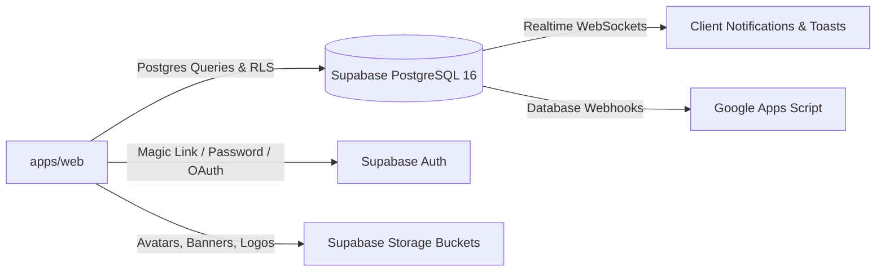

# Hacker's Unity — Third-Party Integrations Guide

> **Document Type:** System Integrations Architecture  
> **Applies to:** External Services, APIs, Webhooks, and Event Hooks  
> **Version:** 2.6.0  
> **Last Updated:** October 2026  

---

## 1. Supabase Integration (Backend as a Service)

Hacker's Unity utilizes Supabase as its primary cloud data and authentication layer:



### 1.1. Client Configuration (`@/utils/supabase/`)
- **Browser Client (`createClient()`):** Configured with `NEXT_PUBLIC_SUPABASE_URL` and `NEXT_PUBLIC_SUPABASE_ANON_KEY`. Safe for client-side state hooks.
- **Server Client (`createServerClient()`):** Extracts and stores sessions directly in HTTP cookies for Server Components and Route Handlers.
- **Admin Client (`createAdminClient()`):** Utilizes `SUPABASE_SECRET_KEY` (service role) to execute administrative actions that bypass RLS (e.g. co-host assignment, automated registrations counter).

### 1.2. Supabase Storage Buckets
- Bucket: `hackathon-assets` (Public)
  - `/avatars/`: 1:1 user profile photos.
  - `/banners/`: 16:9 developer profile covers.
  - `/logos/`: Hackathon logo badges.
  - `/event-banners/`: 16:9 Hackathon showcase banners.

---

## 2. Razorpay Payment Gateway

Enables monetization and ticket sales for paid hackathons and conferences.

### 2.1. Flow Architecture
1. **Order Creation (`POST /api/payments/create-order`):**
   - Server validates hackathon price and creates order via Razorpay Orders API:
     ```ts
     const order = await razorpay.orders.create({
       amount: Math.round(ticketPrice * 100), // amount in paise
       currency: 'INR',
       receipt: `rcpt_${eventId}_${userId.slice(0, 8)}`,
       notes: { eventId, userId }
     });
     ```
2. **Client Checkout Modal:**
   - Client launches `new (window as any).Razorpay(options)` presenting UPI, NetBanking, and Card options.
3. **Verification Endpoint (`POST /api/payments/verify`):**
   - Receives `razorpay_order_id`, `razorpay_payment_id`, and `razorpay_signature`.
   - Computes expected HMAC-SHA256 signature using `RAZORPAY_KEY_SECRET`.
   - On match, sets `registrations.payment_id` and marks registration status as confirmed.
4. **Asynchronous Webhook Listener (`POST /api/webhooks/razorpay`):**
   - Handles `payment.captured` events to reconcile dropped connections.

---

## 3. Real-Time Google Sheets Synchronization

Keeps organizers' private Google Sheets in sync with live registrations.

### 3.1. Architecture
- **Trigger:** Database Webhook on `public.registrations` and `public.submissions` (`sheets-sync-webhooks.sql`).
- **Receiver:** Google Apps Script Web App deployed under the organizer's Google Workspace (`google-apps-script-sync.js`).
- **Data Payload:**
  - Full Name, Email, College, Degree, Graduation Year.
  - Team Name, Squad Code, Role.
  - Custom Questionnaire responses unpacked into dedicated spreadsheet columns.
  - Project Submission URLs (GitHub, Live URL, Video demo).

---

## 4. Transactional Email System (Nodemailer / SMTP)

Dispatches critical platform communications without vendor lock-in.

### 4.1. Supported Providers
- Resend (`smtp.resend.com` on port `465` or `587`)
- Gmail Workspace App Password (`smtp.gmail.com` on port `465`)
- Amazon SES / SendGrid

### 4.2. Transactional Workflows
- **Squad Invitations (`/api/invite-email`):** Branded HTML email with inviter name, hackathon banner, team quota, and 1-click accept deep link (`/hackathons/[slug]/invite?token=...`).
- **Host Broadcasts (`/api/event-broadcast-email`):** Mass announcements to all registered participants.
- **Host Approvals (`/api/host-approval-email`):** Notification to organizers when their hackathon is approved by platform admins.
- **Development Safe Fallback:** If SMTP credentials are missing, emails are logged safely to the console rather than failing the transaction.

---

## 5. AI Judging & Product Evaluation (Groq API)

Automated evaluation engine analyzing hackathon submissions as viable startup products (`brain/judging_evolution.md`).

### 5.1. Engine Details
- **Provider:** Groq Cloud API
- **Model:** `llama3-70b-8192` (Sub-second inference)
- **Evaluation Rubric:**
  1. Problem Urgency & Importance (0-20)
  2. Solution Quality & Differentiation (0-20)
  3. Product-Market Fit & Target User Clarity (0-20)
  4. Business Potential & Scalability (0-20)
  5. Technical Complexity & Execution (0-20)
- **Output:** Structured JSON evaluation report saved to `submissions.ai_score` and `submissions.judge_scores`.
