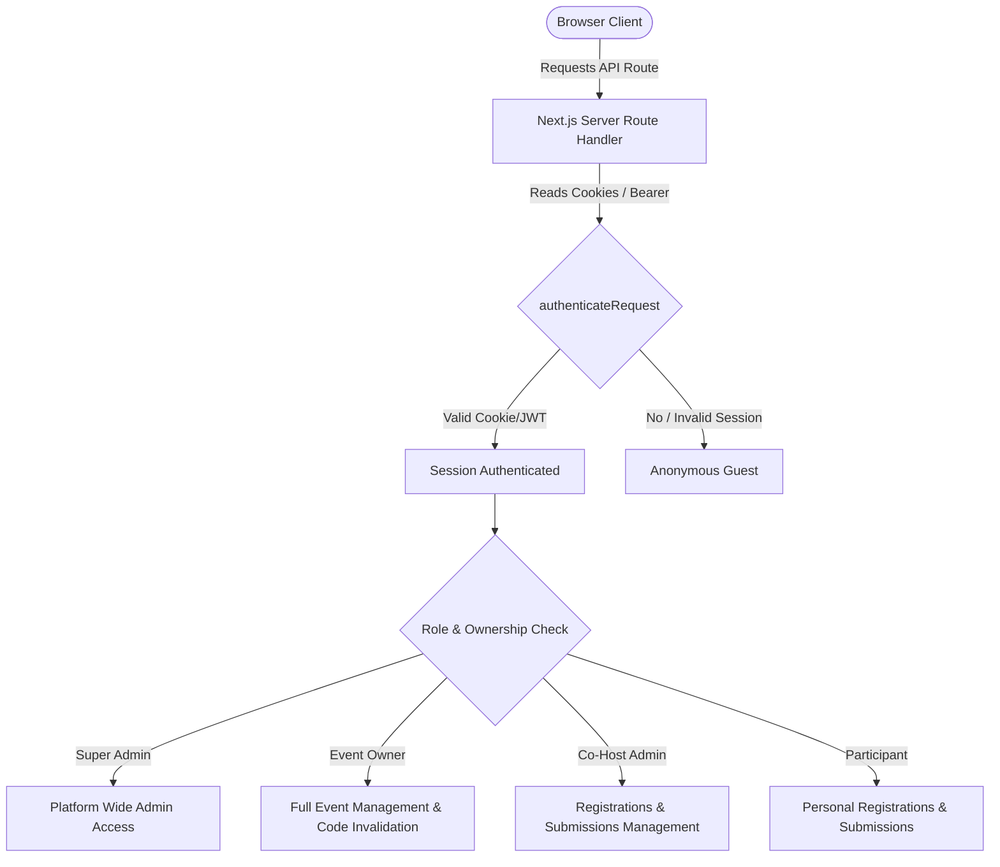

# Hacker's Unity — Security Architecture & Access Control

> **Document Type:** Platform Security Specifications & Access Control Model  
> **Applies to:** Monorepo (`apps/web`, `apps/api`, Supabase Database)  
> **Version:** 2.6.0  
> **Last Updated:** October 2026  

---

## 1. Authentication Layers & Session Lifecycle

Hacker's Unity employs a multi-tiered authentication architecture balancing developer convenience with enterprise-grade session protection:



### 1.1. Client-to-Server Authentication (`@/lib/api-auth`)
1. **Cookie-Based Authentication:** Next.js Server Components and Route Handlers read session tokens from secure HTTP-only cookies managed via `@supabase/ssr`.
2. **Bearer Token Fallback:** For mobile or programmatic API requests, route handlers parse `Authorization: Bearer <token>` and validate the token against `admin.auth.getUser(token)`.
3. **Session Refresh:** Handled automatically at edge middleware without interrupting active user workflows.

---

## 2. Authorization Hierarchy & Role-Based Access Control (RBAC)

The platform enforces 5 distinct authorization tiers:

### 2.1. Platform Super Admin
- **Identification:** `auth.email === process.env.ADMIN_EMAIL` (`chinmaybhatt26@gmail.com`) OR `user.user_metadata?.role === 'ADMIN'`.
- **Capabilities:**
  - Approve or reject community hackathons (`/api/events/approve`).
  - Broadcast push notifications to all users (`/api/events/broadcast-live` & `/admin/notifications`).
  - Manage global news and blog articles.
  - Access any hackathon's organizer dashboard and registrations.

### 2.2. Primary Event Owner (Host)
- **Identification:** `events.organizer_id === auth.userId`.
- **Capabilities:**
  - Full control over event configuration (Dates, tracks, prizes, submission deliverables).
  - Invite and remove Co-Host Admins (`/api/events/team`).
  - Invalidate and regenerate co-host invite links (`hu_adm_...`).
  - Delete or archive the hackathon.
  - Export participant spreadsheets and send broadcast emails.
- **Constraints:** Cannot be removed as event owner.

### 2.3. Co-Host Admin
- **Identification:** Verified record in `public.event_admins` where `event_id === targetEventId` and `user_id === auth.userId`.
- **Capabilities:**
  - Edit event metadata, timeline, and rules.
  - Approve, reject, or waitlist participant registrations.
  - View, grade, and export project submissions.
  - Trigger live announcements.
- **Constraints:**
  - CANNOT delete the hackathon.
  - CANNOT remove the primary host.
  - CANNOT regenerate the admin invite code unless granted explicitly.

### 2.4. Participant / Team Leader
- **Identification:** Verified `user_id` on `registrations`, `teams`, or `submissions`.
- **Capabilities:**
  - Register for hackathons (solo or create squad).
  - Issue cryptographic team invite links (`gen_random_bytes(24)`).
  - Submit projects and view personal participation certificates.

### 2.5. Anonymous / Guest
- Read-only access to published hackathons, leaderboard, blogs, and public profiles.

---

## 3. Cryptographic Token Design

### 3.1. Squad Invitation Tokens
- **Entropy:** 24-byte cryptographically secure random bytes generated via `crypto.randomBytes(24).toString('hex')` (48 hex characters).
- **Storage:** Stored in `public.team_invitations.token` with a unique index.
- **Lifecycle:** Single-use on acceptance or expires when the squad member limit is reached.

### 3.2. Co-Host Admin Invite Codes
- **Format:** `hu_adm_[random_alphanumeric_16]` (e.g. `hu_adm_9a8f2k4m1z7x`).
- **Storage:** Stored in `public.events.admin_invite_code`.
- **Invalidation:** Primary hosts can immediately revoke an active link via the "Regenerate Link" action (`POST /api/events/team` with `action: "regenerate_code"`). Any prior invite URL becomes instantly invalid.

### 3.3. Stateless CSAP Admin Sessions
- **Mechanism:** Signed session cookie (`admin_csap_session`).
- **Signature:** SHA-256 HMAC digest generated from user ID, creation timestamp, and `SUPABASE_SECRET_KEY` salt.
- **Verification:** Evaluated via constant-time comparison `crypto.timingSafeEqual` (`verifyAdminCsapSession` in `@/lib/api-auth`) preventing timing attacks.
- **Expiration:** 7-day hard timeout.

---

## 4. Financial & Payment Security (Razorpay)

1. **Order Generation:** Orders are created exclusively on the server (`/api/payments/create-order`) with server-side prize calculations preventing client manipulation.
2. **Signature Verification:** On client payment completion, the server recalculates:
   $$\text{HMAC-SHA256}(\text{order\_id} + "|" + \text{payment\_id}, \text{RAZORPAY\_KEY\_SECRET})$$
   and verifies that it matches `razorpay_signature` before confirming registration status.
3. **Webhook Idempotency:** The webhook listener (`/api/webhooks/razorpay`) checks whether an order has already been finalized before updating the database.

---

## 5. PostgreSQL Row Level Security (RLS) Policy Guide

All public schema tables enforce RLS:

```sql
-- Example: event_admins table RLS
ALTER TABLE public.event_admins ENABLE ROW LEVEL SECURITY;

-- 1. Anyone authenticated can read event admins for events they belong to
CREATE POLICY "Admins viewable by event team"
ON public.event_admins FOR SELECT
USING (
  auth.uid() = user_id OR
  auth.uid() IN (SELECT organizer_id FROM public.events WHERE id = event_admins.event_id)
);

-- 2. Only event owner can insert new admins via service-role / authorized endpoints
CREATE POLICY "Owner can insert event admins"
ON public.event_admins FOR INSERT
WITH CHECK (
  auth.uid() IN (SELECT organizer_id FROM public.events WHERE id = event_admins.event_id)
);

-- 3. Only owner or self can delete admin record
CREATE POLICY "Owner or self can delete event admins"
ON public.event_admins FOR DELETE
USING (
  auth.uid() = user_id OR
  auth.uid() IN (SELECT organizer_id FROM public.events WHERE id = event_admins.event_id)
);
```

---

## 6. Service Role & Secret Isolation Rules

1. **Zero Secret Leakage:** `SUPABASE_SECRET_KEY`, `RAZORPAY_KEY_SECRET`, and `SMTP_PASS` must NEVER appear in code imported by React client components (`'use client'`).
2. **Dedicated Admin Client:** Route handlers must only call `createAdminClient()` when elevated permissions are strictly required, logging security-sensitive operations.
3. **Safe Fallback Design:** In development or offline mode, storage fallbacks (`lib/storage.ts`) simulate security restrictions and reject unauthorized role modifications.
